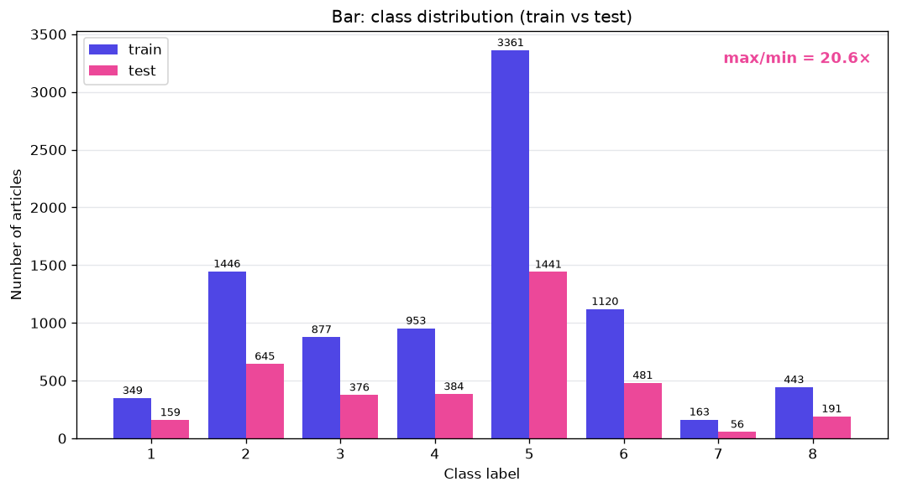
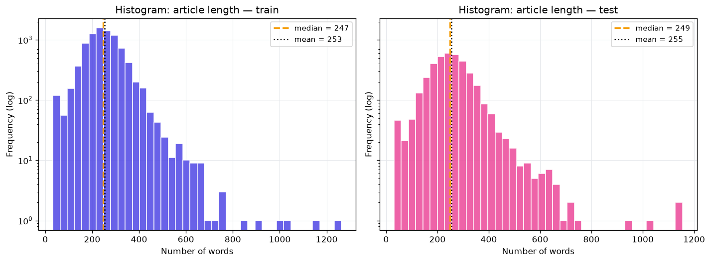
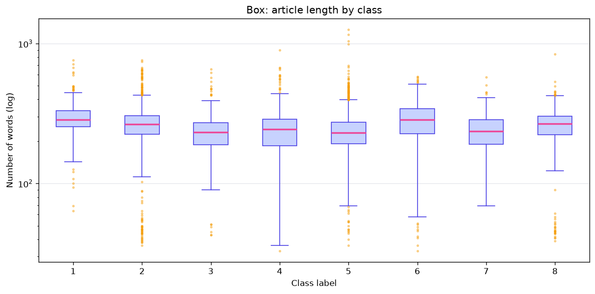
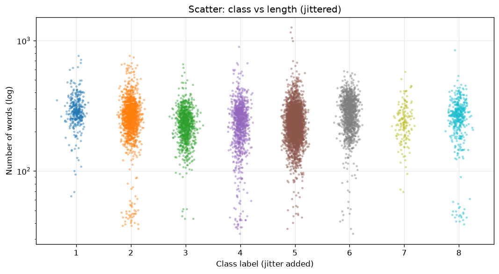
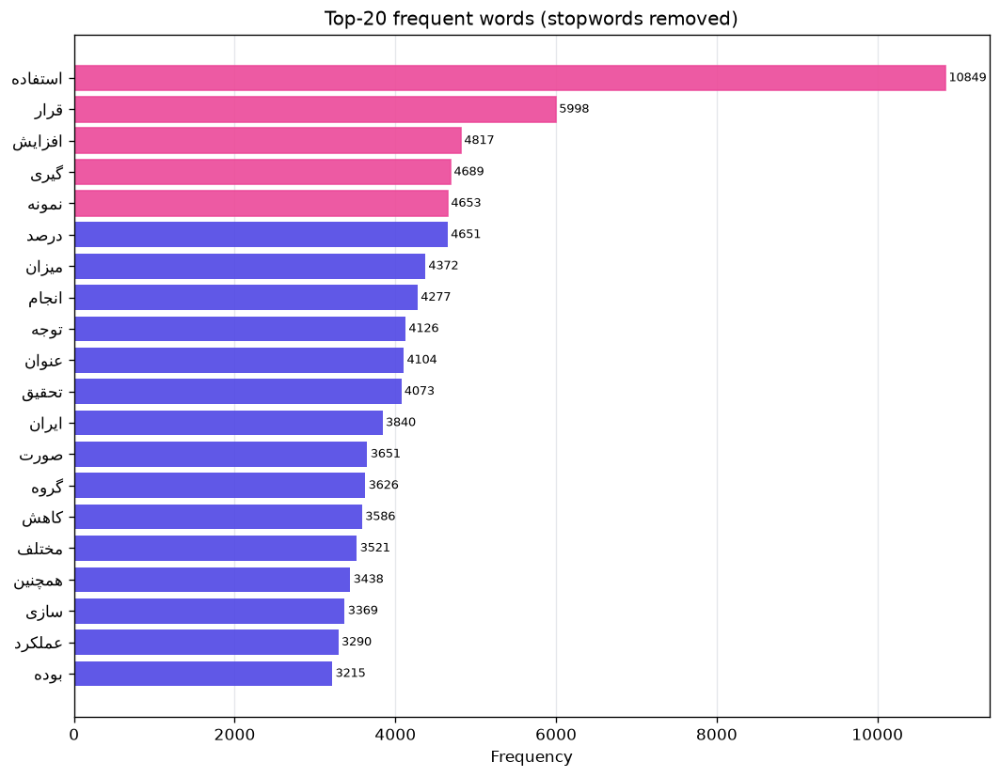
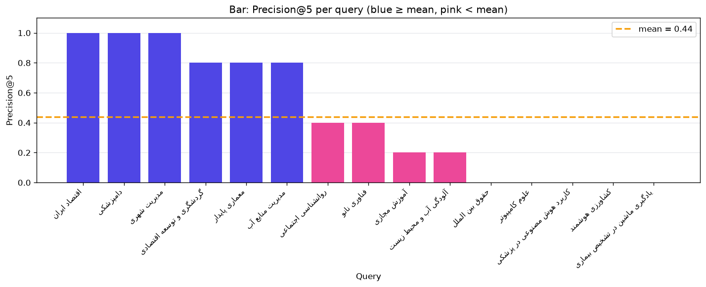

<div dir="rtl">

# سیستم پیشنهاددهنده مقاله از روی متن — گام ۳: مرور داده (EDA)

این مخزن نتیجه گام ۳ پروژه را در بر دارد: سؤال‌های تحلیلی، آمار توصیفی، بررسی کیفیت داده، شش نمودار و تفسیر آنها، و ارزیابی اولیه سیستم پایه (TF-IDF) با معیار `Precision@5`.

## ۱. ساختار پوشه

| فایل | شرح |
|---|---|
| `eda_questions.md` | سند طراحی: چهار سؤال تحلیلی |
| `eda_analysis.py` | کد تحلیل و رسم نمودارها |
| `data_and_evaluation.md` | گزارش آمار توصیفی، کیفیت داده و ارزیابی |
| `figures/` | شش نمودار خروجی (`01` تا `06`) |

## ۲. داده

- **مجموعه‌ها:** `train_clean.csv` (۸٬۷۱۲ رکورد) و `test_clean.csv` (۳٬۷۳۳ رکورد). دو نمونه مشترک بین آموزش و آزمون به‌عنوان نشتی داده حذف شد (`test` از ۳٬۷۳۵ به ۳٬۷۳۳ رکورد رسید).
- **ستون‌ها:**
  - `sentences`: متن مقاله. عنوان و چکیده با یک خط خالی از هم جدا شده‌اند.
  - `labels`: برچسب حوزه علمی، عدد ۱ تا ۸.
  - ستون‌های مشتق‌شده در کد: `title`، `abstract`، `n_words` (تعداد کلمات) و `n_chars` (تعداد نویسه‌ها).
- **نام حوزه‌ها:** کلاس ۵ = علوم اجتماعی، مدیریت و گردشگری؛ کلاس ۷ = علوم سیاسی و روابط بین‌الملل. ⚠️ TODO: نام بقیه کلاس‌ها اضافه شود.
- **منبع و مجوز داده:** ⚠️ TODO: منبع و مجوز دیتاست اینجا نوشته شود.

## ۳. سؤال‌های تحلیلی

| # | سؤال | آمار | نمودار |
|---|---|---|---|
| ۱ | آیا توزیع کلاس‌ها متوازن است؟ | نسبت بزرگ‌ترین به کوچک‌ترین کلاس | میله‌ای (`01`) |
| ۲ | توزیع طول متن چگونه است و آیا نویز یا پرت داریم؟ | میانگین، میانه، صدک ۹۹ | هیستوگرام (`02`)، جعبه‌ای (`03`)، پراکندگی (`04`) |
| ۳ | پرتکرارترین کلمات کدامند و آیا کلمات عمومی غالب‌اند؟ | فراوانی کلمات | میله‌ای افقی (`05`) |
| ۴ | آیا تکراری، خالی یا کوتاه داریم؟ | شمارش | جدول کیفیت داده |

## ۴. آمار توصیفی (تعداد کلمات هر متن)

| شاخص | train | test |
|---|---|---|
| تعداد رکورد | ۸٬۷۱۲ | ۳٬۷۳۳ |
| میانگین | ۲۵۲٫۸۹ | ۲۵۵ |
| میانه | ۲۴۷ | ۲۴۹ |
| واریانس | ۶٬۸۷۰٫۶۱ | — |
| انحراف معیار | ۸۲٫۸۹ | — |
| صدک ۹۹ | ۴۹۷ | — |

## ۵. کیفیت داده

| بررسی | train | test |
|---|---|---|
| مقدار گمشده | ۰ | ۰ |
| متن تکراری | ۰ | ۰ |
| متن خالی | ۰ | ۰ |
| متن کوتاه‌تر از ۲۰ کلمه | ۰ | ۰ |
| متن مشترک بین train و test | ۲ (حذف شد) | |

## ۶. نمودارها و تفسیر (مشاهده ← دلیل ← نتیجه)

### نمودار ۱: توزیع کلاس‌ها



- **مشاهده:** کلاس ۵ با ۳٬۳۶۱ مقاله (۳۸٫۶٪) بزرگ‌ترین و کلاس ۷ با ۱۶۳ مقاله (۱٫۸۷٪) کوچک‌ترین کلاس است. نسبت آنها ۲۰٫۶ برابر است. توزیع test تقریباً شبیه train است (کلاس ۵ با ۱٬۴۴۱ و کلاس ۷ با ۵۶ نمونه).
- **دلیل:** حجم مقالات حوزه‌ها در منبع داده یکسان نیست. آستانه عدم تعادل شدید در سند طراحی ۱۰ برابر بود و اینجا از آن دو برابر بیشتر است.
- **نتیجه:** در مدل‌سازی باید از `macro-F1` و `class_weight='balanced'` (یا نمونه‌برداری مجدد) استفاده شود. چون کلاس ۷ فقط ۵۶ نمونه آزمون دارد، نتیجه ارزیابی آن کلاس پایدار نخواهد بود.

### نمودار ۲: هیستوگرام طول متن



- **مشاهده:** میانگین و میانه نزدیک‌اند (۲۵۳ و ۲۴۷ در train، ۲۵۵ و ۲۴۹ در test). بدنه توزیع متقارن است ولی دم راست بلندی دارد (محور عمودی لگاریتمی است): بلندترین متن‌ها در train حدود ۱٬۲۶۰ کلمه‌اند. در سمت چپ هم یک برآمدگی کوچک حدود ۳۰ تا ۶۰ کلمه دیده می‌شود (حدود ۱۲۰ متن در اولین ستون train).
- **دلیل:** تعداد کمی مقاله خیلی بلند هست و تعدادی چکیده خیلی کوتاه. آستانه ۲۰ کلمه برای نویز آنها را نمی‌گیرد.
- **نتیجه:** `max_length=500` انتخاب منطقی است، چون صدک ۹۹ برابر ۴۹۷ است. متن‌های کمتر از حدود ۶۰ کلمه را بهتر است دستی بررسی کنیم که اطلاعات کافی دارند یا نه.

### نمودار ۳: طول متن به تفکیک کلاس



- **مشاهده:** میانه طول در همه کلاس‌ها نزدیک است (حدود ۲۳۰ تا ۲۹۰ کلمه). کلاس‌های ۱ و ۶ کمی بلندترند و کلاس‌های ۳، ۵ و ۷ کمی کوتاه‌تر. پرت‌های بلند بیشتر در کلاس ۵ دیده می‌شود و پرت‌های کوتاه بیشتر در کلاس‌های ۲ و ۸.
- **دلیل:** احتمالاً سبک و طول معمول چکیده در هر حوزه کمی فرق دارد. این فقط یک فرضیه است و در داده بررسی نشده.
- **نتیجه:** طول متن ویژگی مفیدی برای جداکردن کلاس‌ها نیست. برای هیچ کلاسی لازم نیست برش جداگانه بگذاریم.

### نمودار ۴: پراکندگی کلاس و طول



- **مشاهده:** برای همه کلاس‌ها ابر نقاط در بازه یکسانی (حدود ۱۰۰ تا ۶۰۰ کلمه) قرار دارد و رابطه‌ای بین شماره کلاس و طول دیده نمی‌شود. چند خوشه متن کوتاه (حدود ۴۰ تا ۵۰ کلمه) در کلاس‌های ۲ و ۸ دیده می‌شود.
- **دلیل:** برچسب‌ها اسمی‌اند و ترتیب عددی معنایی ندارد. خوشه‌های کوتاه با برآمدگی سمت چپ نمودار ۲ همخوانی دارد.
- **نتیجه:** نتیجه نمودار ۳ تأیید می‌شود. متن‌های کوتاه کلاس‌های ۲ و ۸ را باید جداگانه بررسی کرد.

### نمودار ۵: ۲۰ کلمه پرتکرار



- **مشاهده:** «استفاده» با ۱۰٬۸۴۹ تکرار با فاصله زیاد اول است، و بعد «قرار» (۵٬۹۹۸)، «افزایش» (۴٬۸۱۷)، «گیری» (۴٬۶۸۹) و «نمونه» (۴٬۶۵۳). هیچ‌کدام از ۲۰ کلمه واژه تخصصی یک حوزه نیست. «گیری» و «سازی» تکه‌های کلمات مرکب‌اند و «همچنین» و «بوده» هنوز در فهرست مانده‌اند.
- **دلیل:** فهرست کلمات توقف کامل نیست. همچنین کد متن را با عبارت منظم `[\w\u0600-\u06FF]+` توکن می‌کند و کلمه‌هایی مثل «نمونه‌گیری» را روی نیم‌فاصله می‌شکند (نزدیک بودن شمارش «نمونه» و «گیری» همین را نشان می‌دهد).
- **نتیجه:** کلمات عمومی چکیده‌نویسی غالب‌اند و شباهت متنی را بالا می‌برند. باید فهرست کلمات توقف گسترش یابد، توکن‌سازی نیم‌فاصله را حفظ کند و در TF-IDF از `max_df` استفاده شود.

### نمودار ۶: Precision@5 برای هر پرس‌وجو



- **مشاهده:** میانگین `Precision@5` برابر ۰٫۴۴۰ است (یعنی حدود ۲٫۲ مقاله مرتبط از هر ۵ پیشنهاد، روی ۱۵ پرس‌وجو).
  - نمره ۱٫۰: «اقتصاد ایران»، «دامپزشکی»، «مدیریت شهری».
  - نمره ۰٫۸: «گردشگری و توسعه اقتصادی»، «معماری پایدار»، «مدیریت منابع آب».
  - نمره ۰٫۴: «روانشناسی اجتماعی»، «فناوری نانو».
  - نمره ۰٫۲: «آموزش مجازی»، «آلودگی آب و محیط زیست».
  - نمره ۰: «حقوق بین‌الملل»، «علوم کامپیوتر»، «کاربرد هوش مصنوعی در پزشکی»، «کشاورزی هوشمند»، «یادگیری ماشین در تشخیص بیماری».
- **دلیل:** نمره صفر یک‌سوم پرس‌وجوها را دارد. دو توضیح محتمل است (هر دو هنوز با بررسی خروجی واقعی تأیید نشده‌اند): اول، ارزیابی با نگاشت دستی `query_label_map` از پرس‌وجو به کلاس ۱ تا ۸ انجام می‌شود و ممکن است با محتوای واقعی کلاس‌ها نخواند. دوم، چند پرس‌وجو (علوم کامپیوتر، هوش مصنوعی، یادگیری ماشین) شاید اصلاً حوزه‌ای در ۸ کلاس داده نداشته باشند.
- **نتیجه:** ۰٫۴۴ برای سیستم پایه TF-IDF نقطه شروع قابل قبولی است. بخشی از ضعف به روش ارزیابی برمی‌گردد و نه فقط مدل. پیش از اینکه مدل را ضعیف بدانیم، باید نگاشت پرس‌وجو به کلاس اصلاح و پرس‌وجوهای خارج از دامنه داده کنار گذاشته شود.

## ۷. جمع‌بندی و گام بعد

1. دیتاست بسیار نامتوازن است (۲۰٫۶ برابر): معیار `macro-F1` و وزن‌دهی کلاس‌ها لازم است.
2. داده تمیز است (بدون گمشده، تکراری یا خالی)، ولی چند صد متن بسیار کوتاه (حدود ۳۰ تا ۶۰ کلمه) باید بررسی شوند.
3. `max_length=500` مناسب است.
4. کلمات پرتکرار عمومی‌اند: فهرست کلمات توقف و توکن‌سازی (نیم‌فاصله) اصلاح شود.
5. ارزیابی را با اصلاح `query_label_map` و حذف پرس‌وجوهای خارج از دامنه تکرار کنیم.

## ۸. اجرای کد

فایل‌های `train_clean.csv`، `test_clean.csv`، `evaluation_queries.csv` و `evaluation_results.csv` باید کنار `eda_analysis.py` باشند (دو فایل آخر خروجی `evaluation.py` است).

```bash
python eda_analysis.py
```

نمودارها در پوشه `figures/` و لاگ کامل در `eda_output.txt` ذخیره می‌شود.

## ۹. اعضای گروه

| نقش | نام |
|---|---|
| طراحی | ⚠️ TODO |
| کد | ⚠️ TODO |
| داده و ارزیابی | ⚠️ TODO |
| مستندات | ⚠️ TODO |

</div>
